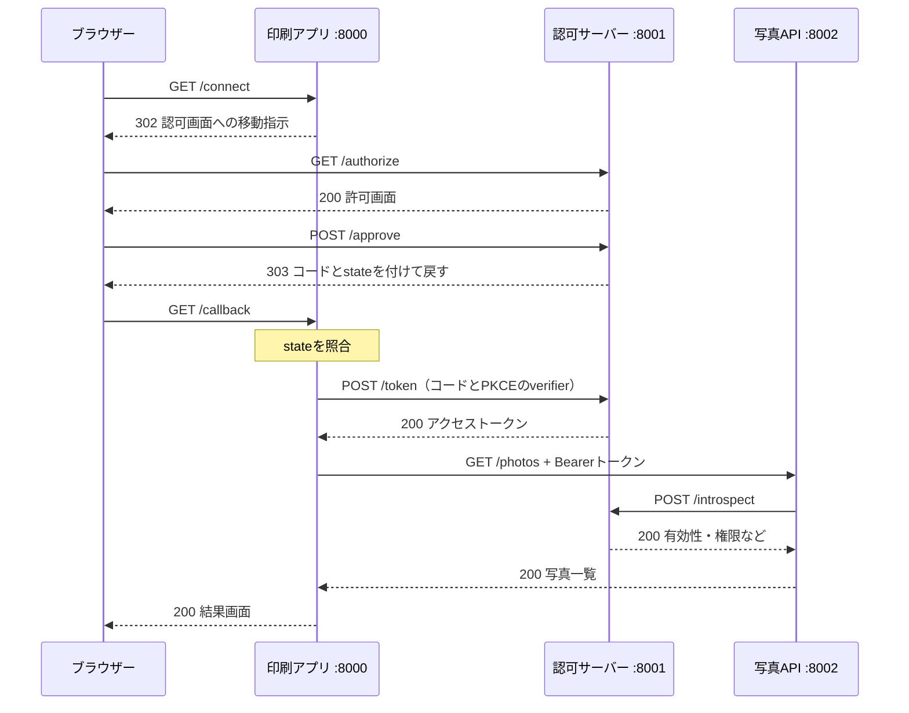

# Pythonで学ぶOAuth 2.0

OAuthの認可コードフローとPKCEを、3つのPythonサーバーで動かして学ぶデモです。写真印刷アプリが利用者の許可を得て、別サービスの写真一覧を取得します。画面に通信履歴を表示し、ブラウザーの移動とサーバー間通信を確認できます。

ローカル学習用の簡略実装です。Aliceとしてログイン済みと仮定し、写真一覧は固定のJSONを返します。実ユーザーのログイン、画像の取得、印刷機能は含みません。

## 構成

| プログラム     | ポート | 役割                                           |
| -------------- | ------ | ---------------------------------------------- |
| 写真印刷アプリ | 8000   | 許可画面への移動、コード交換、写真取得         |
| 認可サーバー   | 8001   | 許可画面、コードとトークンの発行、トークン照会 |
| 写真API        | 8002   | トークンと権限の確認、写真一覧の返却           |



## 必要なもの

- Python 3.11以上
- [uv](https://docs.astral.sh/uv/)
- Webブラウザー
- 空いているポート8000・8001・8002

## 起動手順

リポジトリを取得し、`pyproject.toml` があるフォルダーで実行します。以下はPowerShellでも使えるコマンドです。

```powershell
uv sync --locked
```

同じフォルダーでターミナルを3つ開き、それぞれのコマンドを実行します。

認可サーバー：

```powershell
uv run uvicorn auth_server:app --host 127.0.0.1 --port 8001 --no-access-log
```

写真API：

```powershell
uv run uvicorn resource_server:app --host 127.0.0.1 --port 8002 --no-access-log
```

写真印刷アプリ：

```powershell
uv run uvicorn client_app:app --host 127.0.0.1 --port 8000 --no-access-log
```

ブラウザーで [http://localhost:8000](http://localhost:8000) を開きます。ブラウザーのURLは `localhost` で統一してください。登録済みの戻り先が `http://localhost:8000/callback` のため、`127.0.0.1` に置き換えるとCookieによる操作の対応付けができません。

終了するときは、各ターミナルでCtrl+Cを押します。

## 試すこと

| 操作                                               | 確認する結果                             |
| -------------------------------------------------- | ---------------------------------------- |
| 「写真サービスと連携する」→「許可する」            | Aliceの写真一覧と通信履歴が表示される    |
| 連携を始めて「拒否する」                           | コード交換と写真取得を行わず終了する     |
| トップ画面の「権限不足の実験」から連携し、許可する | トークンは取得できても写真APIが403を返す |

撮影する場合は、コールバックURLのcodeとstateをマスクするか、アドレスバーを撮影範囲から外してください。画面の通信履歴にはトークンの実値を表示しません。サーバーのアクセスログも、URLに含まれるコードを残さないため無効にしています。

## ファイル

| ファイル                     | 内容                                         |
| ---------------------------- | -------------------------------------------- |
| `client_app.py`              | 利用者が操作する印刷アプリ                   |
| `auth_server.py`             | 認可要求・許可操作・コード交換・トークン照会 |
| `resource_server.py`         | 写真API                                      |
| `common.py`                  | 共通設定、PKCE計算、HTML生成                 |
| `check_demo.py`              | 実際のHTTP通信による自動確認                 |
| `pyproject.toml` / `uv.lock` | 依存ライブラリと固定したバージョン           |

各関数には、日本語のGoogle形式docstringで目的・引数・戻り値などを記載しています。

## 仕様とデモ独自の設計

認可要求の項目、コード交換、PKCEの計算・照合、Bearerヘッダーは仕様に基づきます。`/authorize` や `/token` というパス名自体は固定の規則ではありません。

`/connect`、`/approve`、画面の文言、`photos.read` という権限名、Cookie名、保存用の辞書はこのデモで決めたものです。毎回の `/introspect` による照会も、トークンを確認する方法として選んだ構成であり、OAuthの全実装に必須ではありません。

stateは印刷アプリが戻りを照合するために使い、PKCEは認可サーバーがコード交換を照合するために使います。PKCEのverifierは毎回生成してサーバー側へ保存します。Cookieに保存するのはセッション番号だけです。

## 自動確認

手動で起動した3つのサーバーを停止してから実行します。

```powershell
uv run python check_demo.py
```

スクリプトが3サーバーを一時起動し、終了時に停止します。成功すると `PASS:` に続けて確認項目を表示します。

確認対象は、連携成功、拒否、state不一致、許可フォームの照合、不正な戻り先、PKCE不一致、コード再利用、トークンなし・無効、権限不足、照会元の認証です。待ち時間を伴う期限切れの確認は含みません。

## 学習用実装の制約

- HTTPと公開された固定のAPI認証情報を使います。外部公開や本番利用には使わず、実ユーザーの情報を入力しないでください。リポジトリのコード公開とは別の話です。
- 印刷アプリはクライアント認証用の秘密を持ちません。写真APIの照会に使うBasic認証情報は、問い合わせ元を確認するための別の資格情報です。
- 保存先はプロセス内の辞書です。再起動するとセッション・コード・トークンは消えます。複数ワーカーや `--reload` は使いません。
- 認可コードは60秒、トークンと連携操作は300秒で期限切れになります。期限は利用時に確認し、古いデータの定期削除やレート制限は実装していません。
- 複数タブで連携を始めるとCookieが上書きされるため、1つずつ操作してください。

接続できない場合は3サーバーの起動を確認してください。stateのエラーが出た場合は `http://localhost:8000` から連携をやり直します。ポートが使用中なら、同じポートで起動しているプロセスを確認してください。

## 参考資料

- [RFC 6749 — OAuth 2.0](https://www.rfc-editor.org/rfc/rfc6749)
- [RFC 7636 — PKCE](https://www.rfc-editor.org/rfc/rfc7636)
- [RFC 6750 — Bearerトークン](https://www.rfc-editor.org/rfc/rfc6750)
- [RFC 7662 — トークン照会](https://www.rfc-editor.org/rfc/rfc7662)
- [RFC 9700 — OAuthのセキュリティ指針](https://www.rfc-editor.org/rfc/rfc9700)
- [OAuth2.0 PKCEとは 〜Stateとの違い〜（Qiita）](https://qiita.com/ist-n-m/items/992c67b803ff460818ec)
